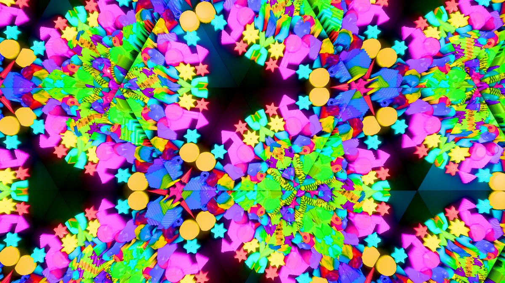

# Kaleidoskop

A real-time kaleidoscope for Linux, Android, the terminal and the web browser. Glass pieces modeled and
rendered in Blender tumble with rigid-body physics in a mirror chamber; fly through an endless mirror
tunnel of glowing stones, let it react to your music, and pick one of nine equalizer displays – from
smooth spectrum bars to two analog VU meters with needles. Always on a true black background with the most
vivid colors, made for OLED screens.




This repository contains the releases only. Download the files from the
[Releases](https://github.com/mimiundmomotv-wq/kaleidoskop/releases) page.

## Downloads

| File | For |
|---|---|
| `kaleidoskop-v<version>-linux-x86_64.tar.gz` | Linux (x86-64): graphical app, terminal version, browser version and the Android app |
| `kaleidoskop-v<version>-android.apk` | Android phones and tablets (Android 8 or newer with Vulkan) |
| `kaleidoskop-v<version>.html` | any web browser, nothing to install |

The on-screen texts are in German.

**New to installing apps from outside an app store?** Follow the step-by-step guide:
[docs/INSTALL.md](docs/INSTALL.md) – for Android, Linux and the browser version.

### Linux

```
tar xzf kaleidoskop-v<version>-linux-x86_64.tar.gz
cd kaleidoskop-v<version>
./install.sh
```

Then start **Kaleidoskop** from the start menu, or run `kaleidoskop` / `kaleidoskop-term`. Everything also
runs straight from the unpacked folder. Requirements, keys and all features are described in the
`README.md` inside the package.

### Android

> [!WARNING]
> **The Android app has not been security-checked.** It is not from the Google Play Store, has not gone through
> Google's review or any independent security audit, and was created with substantial help from an AI. It is
> offered as it is, without any guarantee. Install it only if you accept that risk, and only from this
> repository's Releases page.

To install it, Android has to be allowed to install apps from "unknown sources" – separately for the app you
open the APK with: your **browser** if you open it right after downloading, or your file manager (**Files**,
**My Files** or **Eigene Dateien** on Samsung) if you open it from the Download folder. Google Play Protect may
warn about an unknown app. The [installation guide](docs/INSTALL.md#android) walks through every step,
including how to switch the permission off again afterwards. The music effects listen to the microphone;
the app asks for permission on first start.

## How this was made

Kaleidoskop was created with substantial help from AI. Its author came up with the idea and directed the
project – what to build, how it should look and feel, what to change – and tested every version on real
computers and phones. Almost all of the program code, the shaders, the Blender scripts that model and render
the glass pieces, and the documentation were written by Claude, an AI assistant made by Anthropic, in a long
conversation following those directions and feedback. The glass pieces are procedural models rendered in
Blender; the program contains no third-party artwork apart from the fonts listed in
[THIRD-PARTY-NOTICES.md](THIRD-PARTY-NOTICES.md).

## License

The program files are free to use and to pass on unchanged – see [LICENSE](LICENSE). The source code is not
published. Kaleidoskop is built on open-source components; their licenses and notices are collected in
[THIRD-PARTY-NOTICES.md](THIRD-PARTY-NOTICES.md).
